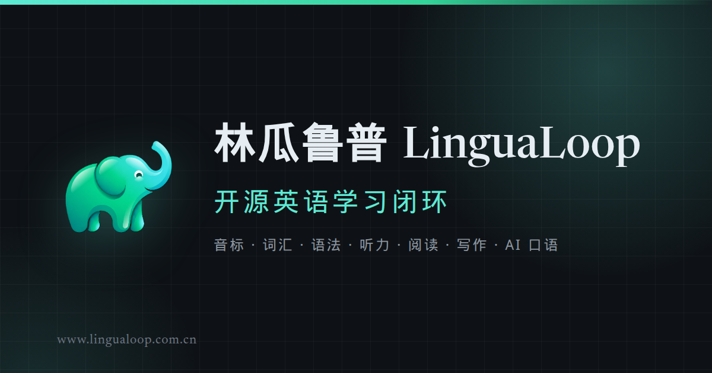

<div align="center">


# LinguaLoop

**最初の発音記号から、最初のリアルな English 会話まで。**

*ローカル利用・マルチデバイス同期・家族共有に柔軟対応する、ソースコード公開型のパーソナル英語学習アシスタント。個人の非商用利用は無料です。*

[English](./README.md) · [简体中文](./README.zh-CN.md) · [繁體中文（香港）](./README.zh-HK.md) · [繁體中文（台灣）](./README.zh-TW.md) · 日本語

[](https://nextjs.org/)
[](https://react.dev/)
[](https://www.typescriptlang.org/)
[](https://tailwindcss.com/)
[](https://supabase.com/)
[](https://github.com/easybuild-jack/lingualoop/stargazers)

[ライブデモ](https://www.lingualoop.com.cn) · [アーキテクチャ (ZH)](./docs/architecture.md) · [開発者ガイド (ZH)](./docs/development.md) · [SEO ガイド (ZH)](./docs/seo.md)

<br />



</div>

---

## ✨ なぜ LinguaLoop なのか？

従来の英語学習アプリは「単語帳はこれ、リスニングは別アプリ、文法はノート、英会話はまた別…」と分断されがちで、覚えた言葉がなかなか口から出てきません。

**LinguaLoop** は、**5 つの技能（聴く・話す・読む・書く・訳す）** と **12 の学習モジュール** をひとつの**連続した学習ループ**に統合しました：

> **基礎固め → 大量インプット → 能動アウトプット** —— 学んだ単語や構文が「わかる・話せる・読める・書ける」まで途切れなく繋がります。

| 5 技能 | 12 モジュール | 50,000+ オフライン語彙 | ソースコード公開 |
| :---: | :---: | :---: | :---: |
| 聴く・話す・読む・書く・訳す | すべてが繋がる学習ループ | 内蔵辞書で瞬時に検索 | 個人利用・セルフホスト無料 |

---

## 🚀 ライブデモ

- **公式サイト**：[https://www.lingualoop.com.cn](https://www.lingualoop.com.cn)
- **登録不要ですぐ使える**：開いたその瞬間から学習スタート（PWA デスクトップインストール対応）。

---

## 🗺️ 英語学習のすべてを網羅する 12 モジュール

| ステップ | モジュールと特徴 |
| --- | --- |
| **1. 基礎 · 発音と語彙** | **発音記号学習**（48 種類の IPA + 42 のフォニックス組合せ、タップで発音）· **発音記号練習**（内蔵 IPA キーボード実践）· **単語学習**（音節分解＆語源タイピング）· **語根・接辞**（同語源ファミリーを体系的に整理） |
| **2. 定着＆ツール** | **苦手・お気に入り単語帳**（**「3 連続正解」記憶定着ルール**）· **オフライン辞書**（5 万語以上を即時検索 + AI 補完）· **単語帳管理**（基礎・CET-4/6・考研・Essential 4000・IT 英語を収録、CSV/TXT/JSON で自由インポート） |
| **3. インプット · 聴く＆読む** | **リスニング広場**（フレーズ・会話・英語ラジオ、倍速＆対訳字幕、ワンクリックで翻訳練習へ連携）· **対訳リーディング**（**発音記号 / 英文 / 和訳の 3 行対照**、単語クリックで即検索＆発音）· **基礎文法**（品詞・16 時制マトリクス・文構造図解） |
| **4. アウトプット · 書く＆話す** | **ディクテーション**（音声を聴いてブラインド入力、ミス単語は自動復習）· **英作文トレーニング**（キーワード予習 → 全文入力 → 語ごとの文法解析）· **AI スピーキング**（日常会話・海外旅行・英語面接・IELTS の実践ロールプレイ、即時の発音・文法フィードバック） |

---

## 🔥 続けたくなる細部へのこだわり

- 🎯 **「3 連続正解」で本当の定着**：タイプミスやヒント閲覧で自動的に苦手リストへ登録され、**3 回連続でノーヒント正解**するまでクリアになりません。
- 🎹 **13 種類の本格メカニカルキーボード打鍵音**：Cherry MX 青軸/茶軸、Topre 静電容量、Alpacas、NovelKeys Creams、IBM Buckling Spring などをリアルサンプリング（Howler.js）。タイピング自体が楽しくなります。
- 🎨 **目に優しい 7 種類のテーマ切替**：集中できるダークテーマから紙の温もりを感じるライトテーマまで、ワンクリックでページ全体を着せ替え。
- 🗣️ **ループの最終段階：AI スピーキング**：カフェ店員・面接官・IELTS 試験官と実践会話。その場で文法・発音をフィードバックし、未知の表現は単語帳へ自動蓄積。

---

## 🌐 用途に合わせて柔軟に

| モード | 特徴 |
| --- | --- |
| 📴 **オフライン対応** | 5 万語以上の辞書と単語帳をローカル読み込み。PWA としてインストールすればオフラインでも完結。 |
| 🔄 **マルチデバイス同期** | 自身の Supabase を接続するだけで、単語帳・苦手リスト・学習進捗を複数端末で同期。 |
| 👥 **チーム・家族共有** | アカウントごとに学習進捗を分離しつつ、単語帳・例文・記事・動画を**チーム共有**して一緒に学習・管理可能。 |
| ✨ **高度なカスタマイズ（BYOK）** | 独自教材のインポート、テーマやショートカットの調整、自分の AI / TTS / ASR キー接続（完全ステートレス転送・サーバー保存なし）。 |

---

## 🛠 技術スタック

| カテゴリ | 採用技術 |
| --- | --- |
| コア | Next.js 16 (App Router) · React 19 · TypeScript 5 |
| UI・アニメーション | Tailwind CSS 4 · Framer Motion · Lucide React |
| 状態管理・ストレージ | Zustand 5 · Dexie.js 4 (IndexedDB) · PWA |
| クラウド同期（任意） | Supabase (`@supabase/supabase-js`) · PostgreSQL RPC |
| 音声・スピーチ | Howler.js · Web Speech Synthesis API · Doubao / Qwen TTS & ASR |

---

## 📦 クイックスタート

### 動作要件

- **Node.js** `>= 20`
- **npm** `>= 10`

### ローカル起動

```bash
# 1. リポジトリをクローン
git clone https://github.com/easybuild-jack/lingualoop.git
cd lingualoop

# 2. 依存パッケージをインストール
npm install

# 3. 開発サーバーを起動（バックエンド・環境変数は不要）
npm run dev
```

ブラウザで `http://localhost:3000` を開くとすぐに学習を始められます。

### よく使うコマンド

```bash
npm run dev       # 開発サーバーを起動
npm run build     # 本番ビルド
npm run start     # 本番サーバーを起動
npm run lint      # ESLint チェック
```

### オプション設定

| 機能 | 設定方法 |
| --- | --- |
| **AI 辞書 / AI チューター / スピーキング** | アプリ右上の「設定 → AI モデル / 音声設定」から自分の API Key を入力（ブラウザ内のみに保存） |
| **マルチデバイス・チーム共有（Supabase）** | 自身の Supabase SQL Editor で [`supabase/schema.sql`](./supabase/schema.sql) を実行し、「設定 → クラウド同期」に Project URL と Anon Key を入力 |
| **独自ドメイン（SEO）** | ビルド前に環境変数 `NEXT_PUBLIC_SITE_URL=https://your-domain.com` を指定（任意） |

---

## 📚 ドキュメント

- 📖 **[アーキテクチャ (ZH)](./docs/architecture.md)**：プロジェクト概要、機能一覧、技術スタック、全体構成図と技術方針
- 🛠 **[開発者ガイド (ZH)](./docs/development.md)**：開発者・AI エージェント向けの実装ルール、主要業務フロー、コーディング規約とチェックリスト
- 🔍 **[SEO ガイド (ZH)](./docs/seo.md)**：ブランド表記ルール、ルート別メタデータ一覧、検索エンジン登録手順
- 🎬 **[公式サンプル追加ガイド (ZH)](./docs/official-samples.md)**：内蔵リスニング動画と翻訳フレーズ集の連携仕様と検証手順

---

## 🤝 フィードバック・Issues

[ライセンス](#-ライセンス)の範囲内で、個人・家族利用のための **Fork**、カスタマイズ、セルフホスティングを歓迎します。バグ報告や機能提案は [Issues](https://github.com/easybuild-jack/lingualoop/issues) よりお知らせください。

---

## 📄 ライセンス

LinguaLoop は **OSI の定義する「オープンソース」ではなく、ソースコード公開型（source-available）のプロジェクト**です。ソースコードは [PolyForm Noncommercial License 1.0.0](./LICENSE)（SPDX：`PolyForm-Noncommercial-1.0.0`）のもとで公開されています。

- ✅ **利用可能**：個人での学習、および個人・家族による非商用目的のセルフホスティング。
- 💼 **作者の事前の書面許諾が必要**：企業での利用、営利の教育・研修機関での利用、有料の製品・サービスへの組み込み、再販売、ホスティングサービスや有料サービスとしての LinguaLoop の提供。
- 📜 正式な条件は [LICENSE](./LICENSE) ファイルをご確認ください。本概要と LICENSE が異なる場合は LICENSE が優先されます。
- 📮 **商用ライセンス**：[Issues](https://github.com/easybuild-jack/lingualoop/issues) にて「Commercial License Inquiry」というタイトルの Issue を作成し、作者にお問い合わせください。

---

## ☕ スポンサー / コーヒーを奢る

**LinguaLoop** が英語学習や開発の役に立ちましたら、ぜひコーヒーを一杯ご支援ください！

<table>
  <tr>
    <td align="center">
      
      <br />
      <sub><b>WeChat Pay</b></sub>
    </td>
    <td align="center">
      
      <br />
      <sub><b>FPS (ZA Bank · ID: 129613600)</b></sub>
    </td>
  </tr>
</table>

---

## ⭐ Star History

このプロジェクトが気に入ったら、ぜひ **Star** で応援してください！

[](https://star-history.com/#easybuild-jack/lingualoop&Date)
