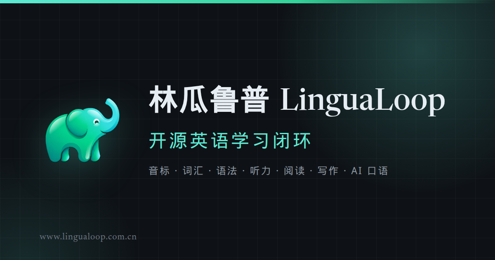

<div align="center">


# LinguaLoop（林瓜鲁普）

**从第一个音标，到第一场 English 对话。**

*一款源码公开、高度灵活的私人英语学习助手 —— 既支持本地离线，也支持跨设备同步与家庭共享；个人非商业使用免费。*

[English](./README.md) · 简体中文 · [繁體中文（香港）](./README.zh-HK.md) · [繁體中文（台灣）](./README.zh-TW.md) · [日本語](./README.ja.md)

[](https://nextjs.org/)
[](https://react.dev/)
[](https://www.typescriptlang.org/)
[](https://tailwindcss.com/)
[](https://supabase.com/)
[](https://github.com/easybuild-jack/lingualoop/stargazers)

[在线体验](https://www.lingualoop.com.cn) · [项目说明文档](./docs/architecture.md) · [开发文档](./docs/development.md) · [SEO 说明](./docs/seo.md)

<br />



</div>

---

## ✨ 为什么做 LinguaLoop？

学英语最怕“割裂”——背词用一个 App、练听力换一个网站、查语法翻笔记、练口语又无从下手，学完就忘、开不了口。

**LinguaLoop（林瓜鲁普）** 把音、词、法、听、读、写、说七个环节连成一个真正的**学习闭环**：

> **打基础 → 大量输入 → 主动输出** —— 让每一个学过的词、练过的句型，最终都能**听得懂、说得出、读得顺、写得对**。

| 5 项技能 | 12 个学习模块 | 5 万+ 离线词条 | 源码公开 |
| :---: | :---: | :---: | :---: |
| 听 · 说 · 读 · 写 · 译 | 环环相扣的学习闭环 | 内置词典秒级查词 | 个人免费 · 自行部署 |

---

## 🚀 在线体验

- **官方体验站**：[https://www.lingualoop.com.cn](https://www.lingualoop.com.cn)
- **免注册即用**：打开网页就能直接学习（支持 PWA 一键安装到桌面，无广告、无套路）。

---

## 🗺️ 一套系统，配齐学英语的全部环节（12 大模块）

| 阶段 | 包含模块与核心体验 |
| --- | --- |
| **1. 打基础 · 发音与词汇** | **音标学习**（48 个国际音标 + 42 个拼读组合，点一下就能听）· **音标练习**（内置 IPA 键盘实战）· **单词学习**（音节拆分 + 词根构词键盘跟打）· **词根词缀**（同源词族图谱串联，学一个通一串） |
| **2. 巩固与工具** | **生错词本**（**「三连对」靶向清零机制**，拒绝虚假记忆）· **单词查询**（5 万+ 离线词条秒查 + AI 分段补全）· **词库管理**（内置基础词 / 四六级 / 考研 / 核心 4000 / IT 词库，支持 CSV/TXT/JSON 自由导入） |
| **3. 输入 · 听与读** | **听力广场**（短语 / 场景对话 / 英语电台，变速播放 + 双语字幕，一键跳转翻译精练）· **双语阅读**（**音标 / 原文 / 译文三行对照**，点词即查即读）· **基础语法**（词性、16 时态矩阵、句子成分推导可视化图解） |
| **4. 输出 · 写与说** | **单词默写**（听音盲打默写，错词自动归集重考）· **句子翻译**（核心词热身 → 整句盲打 → 逐词语法成分拆解）· **AI 口语陪练**（日常闲聊 / 出国旅行 / 职场面试 / 雅思口语真实场景角色扮演，实时纠音与语法反馈） |

---

## 🔥 让人上瘾的细节打磨

- 🎯 **「三连对」才算真的会**：拼错或偷看提示自动进错词本，必须**连续 3 次盲打全对**才清零，彻底告别“看着眼熟以为会了”。
- 🎹 **13 款真实采样机械键盘轴体**：Cherry 青轴/茶轴、Topre 静电容、羊驼轴、奶油轴、IBM 屈伸弹簧……真实击键声 + 通关音效，让背单词和默写像玩机械键盘一样解压上瘾。
- 🎨 **7 套护眼主题一键换肤**：深色沉静专注，浅色纸墨温润，全站 CSS 变量即时切换，长时间学习不累眼。
- 🗣️ **闭环的最后一环：AI 口语陪练**：随时扮演咖啡店员、外企面试官、雅思考官陪你开口练，即时纠错并把生词沉淀回你的专属词库。

---

## 🌐 高度灵活的私人学习系统

| 能力 | 使用体验 |
| --- | --- |
| 📴 **离线可用** | 内置 5 万+ 词条与词库本地加载，支持 PWA 安装到桌面，断网也能完整学习。 |
| 🔄 **跨设备同步** | 按需接入自有 Supabase 云数据库，词库、生错词本与学习进度在多端自由同步。 |
| 👥 **团队 / 家庭共享** | 自建系统账号严格隔离个人进度，可将词库、句库、文章与听力资料设为**团队共享**，大家一起学、一起维护。 |
| ✨ **高度个性化（BYOK）** | 自由导入专属学习内容、定制外观皮肤与快捷键；自填 AI 大模型与语音 Key（服务端无状态转发，永不落盘），打造真正属于自己的私人学习系统。 |

---

## 🛠 技术栈

| 类别 | 技术方案 |
| --- | --- |
| 核心框架 | Next.js 16 (App Router) · React 19 · TypeScript 5 |
| 样式与动效 | Tailwind CSS 4 · Framer Motion · Lucide React |
| 状态与本地存储 | Zustand 5 · Dexie.js 4 (IndexedDB) · PWA |
| 云端同步（可选） | Supabase (`@supabase/supabase-js`) · PostgreSQL RPC |
| 音频与语音 | Howler.js · Web Speech Synthesis API · 豆包 / 千问 TTS & ASR |

---

## 📦 快速开始

### 环境要求

- **Node.js** `>= 20`
- **npm** `>= 10`

### 本地运行

```bash
# 1. 克隆仓库
git clone https://github.com/easybuild-jack/lingualoop.git
cd lingualoop

# 2. 安装依赖
npm install

# 3. 启动开发服务器（无需任何后端或环境变量）
npm run dev
```

启动后在浏览器访问 `http://localhost:3000` 即可开始学习。

### 常用命令

```bash
npm run dev       # 启动本地开发服务器
npm run build     # 构建生产版本
npm run start     # 启动生产服务
npm run lint      # ESLint 代码规范检查
```

### 可选能力配置

| 能力 | 配置方式 |
| --- | --- |
| **AI 查词 / AI 助教 / 口语陪练** | 启动后进入右上角「偏好设置 → AI 模型 / 语音设置」填入自己的 API Key（仅存本机浏览器） |
| **跨设备与团队共享（Supabase）** | 在自己的 Supabase SQL Editor 中执行 [`supabase/schema.sql`](./supabase/schema.sql)，随后在「偏好设置 → 数据同步」填入 Project URL 与 Anon Key |
| **自部署规范域名（SEO）** | 构建前设置环境变量 `NEXT_PUBLIC_SITE_URL=https://your-domain.com`（可选） |

---

## 📚 相关文档

- 📖 **[项目说明文档](./docs/architecture.md)**：项目定位、功能版图、技术栈、总体架构图与核心技术路线
- 🛠 **[开发文档](./docs/development.md)**：面向开发者与 AI 助手的参考手册（架构红线、核心业务流程、编码规范与验证清单）
- 🔍 **[SEO 说明](./docs/seo.md)**：品牌规范、路由元数据清单与搜索引擎提交流程
- 🎬 **[官方示例接入说明](./docs/official-samples.md)**：听力视频与翻译句库联动机制及校验方法

---

## 🤝 反馈与交流

欢迎在[许可证](#-许可证)允许的范围内 **Fork** 本项目并自行部署，打造属于个人或家庭的英语学习系统。如果在使用过程中遇到问题、发现 Bug 或有功能建议，欢迎前往 [Issues](https://github.com/easybuild-jack/lingualoop/issues) 反馈交流。

---

## 📄 许可证

LinguaLoop 是**源码公开（source-available）项目，而非 OSI 定义的开源项目**。源代码依据 [PolyForm Noncommercial License 1.0.0](./LICENSE)（SPDX：`PolyForm-Noncommercial-1.0.0`）公开发布。

- ✅ **允许**：个人学习，以及个人或家庭在无商业目的下自行部署使用。
- 💼 **须事先获得作者书面授权**：公司使用、商业培训机构使用、用于付费产品或服务、转售，或将 LinguaLoop 作为托管服务 / 付费服务对外提供。
- 📜 完整条款以 [LICENSE](./LICENSE) 文件为准；本摘要如与 LICENSE 不一致，以 LICENSE 为准。
- 📮 **商业授权**：请在 [Issues](https://github.com/easybuild-jack/lingualoop/issues) 中创建标题为「Commercial License Inquiry（商业授权咨询）」的 Issue 联系作者。

---

## ☕ 赞赏支持

如果 **LinguaLoop（林瓜鲁普）** 对你的英语学习或项目开发有帮助，欢迎请作者喝杯咖啡！

<table>
  <tr>
    <td align="center">
      
      <br />
      <sub><b>微信支付</b></sub>
    </td>
    <td align="center">
      
      <br />
      <sub><b>转数快 FPS（ZA Bank · ID: 129613600）</b></sub>
    </td>
  </tr>
</table>

---

## ⭐ Star History

如果这个项目对你有帮助，欢迎点一个 **Star** 支持一下！

[](https://star-history.com/#easybuild-jack/lingualoop&Date)
