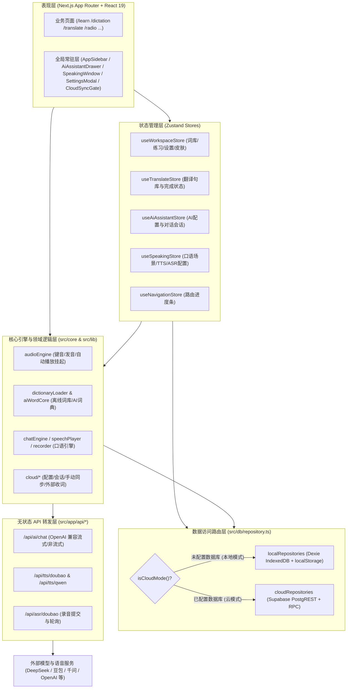

# LinguaLoop 项目说明与技术架构

> **LinguaLoop（林瓜鲁普）** 是一款开源、高度灵活、完全自由的私人英语学习助手——既支持本地离线，也支持跨设备同步与家庭/团队共享，将**音标发音、词汇记忆、词根词缀、语法图解、双语阅读、听力磨耳、句子翻译、AI 助教与 AI 口语陪练**串联成一个完整的「听 · 说 · 读 · 写 · 译」学习闭环。

---

## 1. 设计理念与总体技术路线

LinguaLoop 的技术路线围绕三个核心原则展开：

1. **高度灵活的运行模式（本地 / 跨设备 / 团队共享自由切换）**
   - **本地模式**：零后端依赖、免注册登录，打开网页即可通过 `IndexedDB` + `localStorage` 完成全部学习与进度持久化，并支持 PWA 安装离线使用。
   - **跨设备与团队共享模式**：接入自己的 Supabase（或兼容 PostgreSQL / PostgREST 实例）即可切换至云端 Repository；通过应用自建 `accounts` 表实现个人学习进度严格隔离，自定义词库/句库/阅读/视频支持「共享 / 个人」灵活可见性控制。
   - **「是否配置数据库」本身就是模式开关**，个人、家庭或小团队可按需自由选择。
2. **完全自由与数据主权**
   - 所有自定义内容、学习进度和数据库均归用户自己掌控；本地与云端之间采用幂等加法手动同步，避免隐式覆盖。
3. **BYOK 无状态 AI 能力（Bring Your Own Key）**
   - AI 查词补全、AI 助教对话、AI 口语陪练（大模型 + TTS 语音合成 + ASR 语音识别）均由用户在浏览器端自行配置模型 Key。
   - 服务端仅提供**极薄的无状态转发代理**（解决浏览器 CORS 与上游鉴权头限制），**不落盘、不存库、不记录用户凭证与音频**。

---

## 2. 功能版图与路由总览

| 模块 | 路由 | 核心能力 |
| --- | --- | --- |
| 产品首页 | `/` | 品牌展示、学习闭环演示、主题皮肤切换 |
| 音标学习 | `/phonetics/learn` | 48 个国际音标矩阵、发音口型/例词听辨、自然拼读组合 |
| 音标与发音练习 | `/phonetics` | 听音辨音、看词写音标、内置 IPA 键盘拼写 |
| 英语词库管理 | `/books` | 5 套内置官方词库（基础词/四六级/考研/核心4000/IT）+ 自定义词库导入与单元进度总览 |
| 单词学习 | `/learn` | 音节切分拼读、词根词缀拆解、键盘盲打、例句点词即查 |
| 默写练习 | `/dictation` | 听音/看释义拼写默写、错词自动归集、单元末错词重考 |
| 生错词本 | `/errors` | 生词本与错词本管理、错词攻坚专项训练（连续答对自动移出） |
| 词根词缀 | `/roots` | 拉丁/希腊词根、常用前后缀图谱、搜索与掌握标记 |
| 英语语法 | `/grammar` | 词性、句子推导与成分、16 时态矩阵、介词图解 |
| 英语词典 | `/dictionary` | 离线索引 + AI 分段补全（音节/词源/例句/短语）、查词历史、一键加星 |
| 双语阅读 | `/reading` | 中英双语对照精读、点词查词、支持自定义文章上传 |
| 听力广场 | `/radio` | 常用短语/场景对话/英语电台音视频播放、倍速与循环、联动翻译练习 |
| 句子翻译 | `/translate` | 核心词热身 → 整句下划线槽位拼写 → 逐词语法成分解析，支持自定义句库导入 |
| 账号登录 | `/login` | 仅云模式下使用，支持系统账号注册、登录与切换 |
| AI 助教 & 口语陪练 | 全局悬浮窗 | 右侧常驻 AI 助教抽屉 + 全局口语陪练悬浮窗（多场景/CEFR 等级/实时纠错） |

---

## 3. 技术栈选型

| 层次 | 选型 | 说明 |
| --- | --- | --- |
| 应用框架 | **Next.js 16 (App Router)** + **React 19** | 统一承载前端页面、SEO 元数据与无状态 API 转发路由 |
| 语言与类型 | **TypeScript 5**（`strict: true`） | 全链路静态类型约束，路径别名 `@/* -> ./src/*` |
| 样式与动效 | **Tailwind CSS v4** + **Framer Motion** + **Lucide React** | CSS 变量驱动的多皮肤系统，平滑过渡与微交互 |
| 客户端状态 | **Zustand 5**（`persist` 中间件） | 按业务域拆分为工作台、翻译、AI 助教、口语、导航 5 个 Store |
| 本地持久化 | **Dexie.js 4 (IndexedDB)** + `localStorage` | 承载词库、学习进度、错词记录、AI 词典缓存与用户偏好 |
| 可选云端数据库 | **Supabase (`@supabase/supabase-js`) / PostgreSQL** | `schema_version = 2`，含 RPC 事务函数与账号隔离触发器 |
| 音频引擎 | **Howler.js** + HTML5 Audio + **Web Speech Synthesis API** | 机械键盘轴体音效、单词/例句发音播放与降级兜底 |
| 离线与分发 | **PWA**（`manifest.json` + `sw.js`）+ Next.js Metadata SEO | 支持桌面安装、离线缓存及搜索引擎基础收录 |

---

## 4. 总体系统架构



---

## 5. 核心技术路线详解

### 5.1 数据分层与双模式 Repository 架构

为了兼顾「零配置离线可用」与「多设备数据共享」，系统将全部数据划分为三类：

| 数据类别 | 具体内容 | 本地模式 | 云模式 |
| --- | --- | --- | --- |
| **业务数据** | 自定义词库、单词掌握/生错词记录、单元进度、书内位置、自定义翻译句库/完成记录、自定义阅读文章、自定义听力视频 | IndexedDB (`LinguaLoopDB`) + `localStorage` | Supabase PostgreSQL（按 `account_id` 隔离） |
| **可重建缓存** | 5 套内置官方词库 JSON、官方示例句库/视频、`aiWordCache`（本地离线词表索引 + AI 查词缓存） | `public/dicts/*.json` + IndexedDB `aiWordCache` | **保持本地，不入云库** |
| **设置与凭据** | AI API Key、TTS/ASR 凭据、Supabase 连接配置、主题皮肤、键音与音量、快捷键、音标偏好 | `localStorage` | **永远只留本机，不入云库** |

关键设计点：
- **单一业务层**：`src/db/index.ts` 中的业务逻辑只调用 `getRepositories()`，不关心底层是 Dexie 还是 Supabase。
- **确定性 ID**：单词 ID 由拼写经 `buildWordId(name)` 确定性派生（`word_<slug>`），确保官方词库 JSON 与云端进度解耦关联，跨词库共享掌握度。
- **两类云端表与权限模型**（详见 `supabase/schema.sql`）：
  - **进度类表**（`word_records`、`unit_progress`、`book_progress`、`word_overrides`、`app_state`、`translate_state`）：`account_id NOT NULL`，严格属于当前登录账号。
  - **内容类表**（`vocab_books`、`translate_books`、`reading_articles`、`radio_items`、`collected_words`）：`account_id` 可空，`NULL` 表示全家/团队共享，非空表示个人私有。
- **手动加法同步**：本地数据与云端之间不做隐式双向自动同步，只在「设置 → 数据同步」提供**同步资料**与**同步进度**两个幂等、只增不减的手动同步入口（`src/core/cloud/manualSync.ts`），避免多端覆盖丢数据。

### 5.2 离线词库与 AI 分段补全架构

- 内置官方词库以静态 JSON 存放在 `public/dicts/`，支持配套 `*.units.json` 定义语义单元（无目录时按 `unitSize` 自动切片）。
- 查词与导入统一走 `aiWordCore` + IndexedDB `aiWordCache`：优先命中本地缓存，未命中时请求大模型生成基础释义与音标，并由 `useEnsureAiWordSections` 按需分段异步补全音节、例句、短语与词源拆解，降低首屏等待耗时。

### 5.3 无状态服务端代理（AI / TTS / ASR）

`src/app/api/` 仅保留 4 个无状态转发接口：
- `POST /api/ai/chat`：转发 OpenAI 兼容的 Chat Completions 请求（支持 SSE 流式与非流式）。
- `POST /api/tts/doubao` / `POST /api/tts/qwen`：转发火山引擎（V3/V1）与阿里云百炼 Qwen-TTS 语音合成，直接返回音频二进制流。
- `POST /api/asr/doubao`：接收浏览器录制的 WAV 音频，向火山引擎录音文件识别 2.0 提交任务并轮询返回识别文本。

所有接口均从请求体动态获取用户凭证，仅在单次请求内存中组装请求头，不写日志、不落盘、不缓存用户内容。

### 5.4 音频与交互引擎

- **多通道音频管理**（`src/core/audioEngine.ts`）：统一管理机械键盘轴体按键音（Howler.js）、在线词典真人发音、例句朗读及 Web Speech Synthesis 兜底。
- **自动播放策略兼容**：针对浏览器拦截页面刚加载时的自动发音（如默写页首词听音），实现「挂起队列 + 首次用户手势自动补播」机制。
- **全局快捷键**：`src/lib/shortcuts.ts` 支持自定义快捷键录制、冲突处理与跨平台展示。

### 5.5 皮肤系统、PWA 与 SEO

- **皮肤系统**：`src/lib/skins.ts` 定义多套深色主题 Token，`SkinApplier` 在挂载时将 CSS 变量注入根节点，组件层统一使用语义化变量（`bg-background`、`text-primary`、`border-border` 等）。
- **PWA**：通过 `public/manifest.json`、`public/sw.js`、`PwaRegistrar` 与 `PwaInstallPrompt` 提供安装与缓存能力。
- **SEO**：由 `src/lib/seo.ts` 集中维护站点元数据、路由级 `buildPageMetadata`、`robots.ts`、`sitemap.ts` 与首页 JSON-LD（详见 [seo.md](./seo.md)）。

---

## 6. 目录结构总览

```text
lingualoop/
├── docs/                       # 项目文档（架构、开发指南、SEO、官方示例接入）
├── public/
│   ├── dicts/                  # 内置官方词库 JSON 与语义单元目录 (*.units.json)
│   ├── manifest.json / sw.js   # PWA 清单与 Service Worker
│   └── ...                     # Logo、图标与 OG 分享图
├── scripts/                    # 词库处理、官方示例校验与云端 E2E 测试脚本
├── supabase/
│   └── schema.sql              # Supabase / PostgreSQL v2 建表、触发器与 RPC 脚本
└── src/
    ├── app/                    # Next.js App Router 页面、layout 与无状态 API 路由
    ├── components/             # 按业务域划分的 React UI 组件
    ├── core/                   # 核心基础设施（audioEngine、dictionaryLoader、cloud/*）
    ├── db/                     # IndexedDB 定义 (local.ts)、Repository 路由与业务操作
    ├── hooks/                  # 通用业务 Hooks（键盘输入、AI 分段补全等）
    ├── lib/                    # 纯函数工具库（音节切分、句子解析、AI/TTS/ASR 封装、SEO、皮肤）
    ├── resources/              # 内置静态数据（词库元数据、词根、语法、音标、官方阅读/听力/翻译）
    ├── store/                  # Zustand 状态管理
    └── types/                  # 全局 TypeScript 数据模型定义
```

---

## 7. 部署与环境变量

LinguaLoop 默认无需任何环境变量即可运行：

```bash
npm install
npm run dev      # 本地开发 http://localhost:3000
npm run build    # 生产构建
npm run start    # 启动生产服务
```

| 环境变量 | 必填 | 默认值 | 说明 |
| --- | --- | --- | --- |
| `NEXT_PUBLIC_SITE_URL` | 否 | `https://www.lingualoop.com.cn` | 构建期规范域名，用于 canonical、sitemap 与 OG 元数据；自部署时建议改为自己的站点域名 |

> **说明**：AI 模型、TTS/ASR 语音服务和 Supabase 数据库连接信息均由用户在浏览器端「偏好设置」中按需配置，不通过服务端环境变量硬编码，确保多用户自部署与本地隐私安全。

